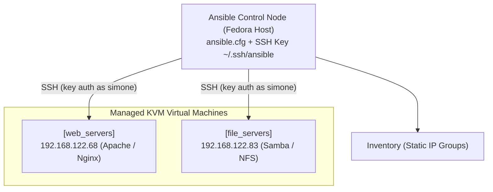

# Ansible Configuration Management & Playbooks

Infrastructure as Code (IaC) configuration management and automated provisioning across KVM virtual machines (Fedora & Ubuntu) using **Ansible** playbooks, reusable roles, modular inventories, and privilege escalation.

---

## 🏗️ Architecture & Control Topology



---

## ⚙️ Global Configuration (`ansible.cfg`)

```ini
[defaults]
inventory = ./inventory
remote_user = simone
private_key_file = /home/yasir/.ssh/ansible
interpreter_python = auto_silent
result_format = yaml
```

### Static Inventory Definition (`inventory`)
```ini
# Ungrouped hosts
192.168.122.83
192.168.122.68

[web_servers]
192.168.122.68

[file_servers]
192.168.122.83
```

---

## 🚀 Bootstrap Playbook (`bootstrap.yaml`)

Ensures newly created KVM nodes are updated, creates an administrative automation service user (`simone`), configures passwordless sudo, and deploys SSH public keys:

```yaml
---
- hosts: all
  become: true
  pre_tasks:

  - name: Install system updates (Fedora / RHEL)
    dnf:
      update_only: yes
      update_cache: yes
    when: ansible_facts['distribution'] == 'Fedora'

  - name: Install system updates (Ubuntu / Debian)
    apt:
      upgrade: dist
      update_cache: yes
    when: ansible_facts['distribution'] == 'Ubuntu'
  
  tasks:

  - name: Create automation service user (simone)
    user:
      name: simone
      groups: root
      shell: /bin/bash

  - name: Deploy authorized SSH key for simone
    authorized_key: 
      user: simone
      key: "ssh-ed25519 AAAAC3NzaC1lZDI1NTE5AAAAI... yasir@homenode"

  - name: Configure passwordless sudo for simone
    copy:
      src: sudoer_simone
      dest: /etc/sudoers.d/simone
      owner: root
      group: root
      mode: 0440
```

---

## 📦 Modular Roles & Site Orchestration (`site.yaml`)

```yaml
---
- hosts: all
  become: true
  pre_tasks:

  - name: Update RedHat family packages
    dnf:
      name: "*"
      state: latest
    changed_when: false
    when: ansible_facts['os_family'] == 'RedHat'

  - name: Update Debian family packages
    apt:
      update_cache: yes
    changed_when: false
    when: ansible_facts['os_family'] == 'Debian'

- hosts: all
  become: true
  roles:
    - base

- hosts: web_servers
  become: true
  roles: 
    - web_servers

- hosts: file_servers
  become: true
  roles:
    - file_servers
```

---

## 💡 Practical Ansible Ad-Hoc Commands

Run ad-hoc tasks across the inventory without writing YAML:

```bash
# Ping connectivity across all hosts
ansible all -m ping

# Check host disk usage
ansible all -a "df -h /"

# Install htop package on all web servers
ansible web_servers -m package -a "name=htop state=present" --become

# Restart web server service
ansible web_servers -m service -a "name=httpd state=restarted" --become
```
