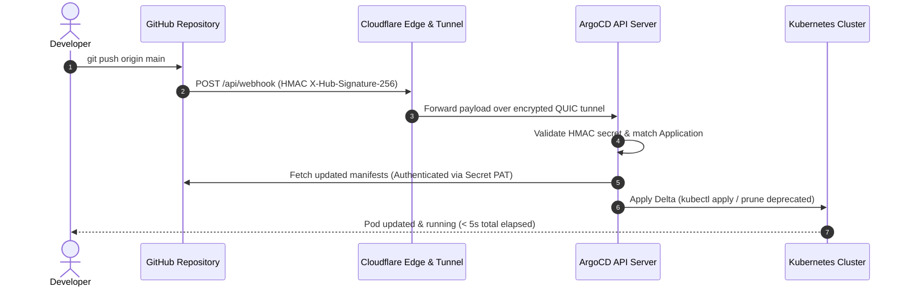

# Zero-Delay Kubernetes GitOps with ArgoCD

Automated, continuous GitOps delivery pipeline running on a local home server with Cloudflare Tunnel ingress, out-of-band webhook synchronization, and private GitHub repository authentication.

---

## System Architecture & Data Flow

Every `git push` triggers an HMAC-authenticated webhook payload through the Cloudflare edge directly to the ArgoCD API server. This completely eliminates ArgoCD's default 3-minute poll interval, reconciling workloads in **sub-5 seconds**.


---

## Core Pillars of the Architecture

| Pillar | Technical Mechanism | Production Benefit |
| :--- | :--- | :--- |
| **Zero-Delay GitOps** | GitHub Webhook calls ArgoCD `/api/webhook` | Bypasses 3-minute polling loop; triggers instant reconcile. |
| **Zero Inbound Ports** | `cloudflared` maintains an outbound QUIC tunnel to Cloudflare Edge | Zero router port forwarding; public WAN IP remains hidden. |
| **Private Repo Access** | Scoped GitHub Personal Access Token (PAT) in native K8s Secret | Secure manifest pulling from private repositories without leaking credentials. |
| **Self-Healing Sync** | `syncPolicy.automated` with `prune: true` and `selfHeal: true` | Cluster auto-heals manual drift and prunes removed resources. |
| **Local AI Workloads** | Open WebUI frontend connected to bare-metal RAMen AI | Unthrottled AVX CPU inference with persistent KV-cache attention slots. |

---

## Deployment Lifecycle: Push to Live in < 5s



---

## Step-by-Step Configuration

### 1. Cloudflare Tunnel Deployment in Kubernetes

To provide an ingress route for GitHub webhooks and public services without opening inbound router ports, `cloudflared` is deployed natively inside the cluster:

```yaml
# infra/cloudflared/deployment.yml
apiVersion: apps/v1
kind: Deployment
metadata:
  name: cloudflared
  namespace: infra
spec:
  replicas: 1
  selector:
    matchLabels:
      app: cloudflared
  template:
    metadata:
      labels:
        app: cloudflared
    spec:
      containers:
      - name: cloudflared
        image: cloudflare/cloudflared:latest
        args:
        - tunnel
        - --no-autoupdate
        - run
        - --token
        - $(TUNNEL_TOKEN)
        env:
        - name: TUNNEL_TOKEN
          valueFrom:
            secretKeyRef:
              name: cloudflare-tunnel-secret
              key: token
        resources:
          limits:
            cpu: 200m
            memory: 256Mi
          requests:
            cpu: 50m
            memory: 64Mi
```

### 2. Configuring the Webhook Secret in ArgoCD

ArgoCD validates webhook signatures to prevent unauthorized sync triggers. We inject the shared secret into the `argocd-secret` resource:

```bash
# Generate a cryptographically secure token
WEBHOOK_SECRET=$(openssl rand -hex 20)

# Patch ArgoCD secret
kubectl -n argocd patch secret argocd-secret \
  -p "{\"stringData\": {\"webhook.github.secret\": \"$WEBHOOK_SECRET\"}}"
```

In GitHub:
1. Navigate to **Repository Settings** > **Webhooks** > **Add webhook**.
2. **Payload URL**: `https://argocd.homenode.online/api/webhook`
3. **Content type**: `application/json`
4. **Secret**: Insert the generated `$WEBHOOK_SECRET`.
5. **Events**: Select *Just the push event*.

### 3. Private Repository Authentication (Native K8s Secret)

For private repositories, ArgoCD authenticates using a fine-grained GitHub Personal Access Token (PAT) configured with read-only repository permissions:

```yaml
apiVersion: v1
kind: Secret
metadata:
  name: github-repo-credentials
  namespace: argocd
  labels:
    argocd.argoproj.io/secret-type: repository
stringData:
  type: git
  url: https://github.com/aayasir2177/homeserver-gitops-.git
  username: aayasir2177
  password: ghp_yourPersonalAccessTokenHere
```

> [!NOTE]
> Labeling the secret with `argocd.argoproj.io/secret-type: repository` allows ArgoCD's repo-server to dynamically discover and mount credentials without modifying application definition YAMLs.

### 4. Self-Healing Application Definition

```yaml
apiVersion: argoproj.io/v1alpha1
kind: Application
metadata:
  name: podinfo
  namespace: argocd
spec:
  project: default
  source:
    repoURL: 'https://github.com/aayasir2177/homeserver-gitops-.git'
    targetRevision: HEAD
    path: apps/podinfo
  destination:
    server: 'https://kubernetes.default.svc'
    namespace: default
  syncPolicy:
    automated:
      prune: true      # Automatically delete resources removed from Git
      selfHeal: true   # Automatically revert manual kubectl edits
    syncOptions:
      - CreateNamespace=true
```

---

## Verification & Troubleshooting

To monitor webhook arrival in real time, stream logs from the ArgoCD API server:

```bash
kubectl logs -n argocd deployment/argocd-server -f | grep -i -E "webhook|push|refresh"
```

Expected log output on git push:
```json
{"level":"info","msg":"Received push event repo: https://github.com/aayasir2177/homeserver-gitops-","time":"2026-11-13T19:02:11Z"}
{"level":"info","msg":"Requested app refresh for 'podinfo'","time":"2026-11-13T19:02:11Z"}
{"level":"info","msg":"Comparing app state (at 6cb58783c7ab)","time":"2026-11-13T19:02:12Z"}
```
Cluster sync concludes in approximately 2 to 4 seconds.
