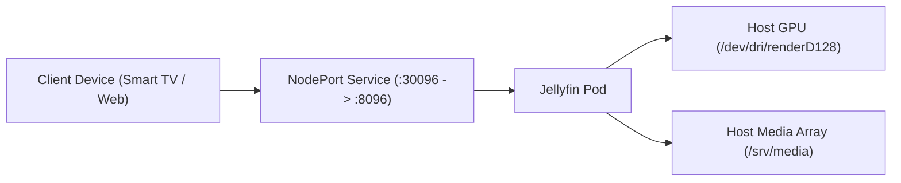

# Production Jellyfin Media Server on Kubernetes

Hands-on deployment of an accelerated Jellyfin media streaming server in a homelab Kubernetes cluster featuring persistent `hostPath` storage, NodePort networking, and GPU device pass-through for hardware transcoding.

---

## Architecture & Strategy

Instead of relying on black-box Helm charts or boilerplate templates, this deployment follows a structured, educational DevOps pattern:
1. Generate the initial manifest structure imperatively using `kubectl --dry-run=client`.
2. Augment the YAML with hardware-level device mounts (`/dev/dri`) to allow Intel QuickSync / VAAPI GPU hardware acceleration inside unprivileged containers.
3. Bind media libraries directly to high-throughput host storage paths via `hostPath` volume mounts.



---

## Step 1: Imperative Manifest Generation

Start by scaffolding the base deployment without applying it to the cluster:

```bash
kubectl create deployment jellyfin \
  --image=linuxserver/jellyfin:latest \
  --port=8096 \
  --dry-run=client \
  -o yaml > jellyfin-deployment.yaml
```

---

## Step 2: Final Production Manifest

The base manifest is customized with environment variables, security context for GPU access, and persistent volume configurations:

```yaml
apiVersion: apps/v1
kind: Deployment
metadata:
  name: jellyfin
  namespace: media
  labels:
    app: jellyfin
spec:
  replicas: 1
  selector:
    matchLabels:
      app: jellyfin
  template:
    metadata:
      labels:
        app: jellyfin
    spec:
      containers:
      - name: jellyfin
        image: linuxserver/jellyfin:latest
        ports:
        - containerPort: 8096
          name: http
        env:
        - name: PUID
          value: "1000"
        - name: PGID
          value: "1000"
        - name: TZ
          value: "Asia/Karachi"
        securityContext:
          privileged: true  # Required for direct /dev/dri device access
        volumeMounts:
        - name: config-storage
          mountPath: /config
        - name: media-storage
          mountPath: /data/movies
        - name: dri-device
          mountPath: /dev/dri
        resources:
          requests:
            cpu: 500m
            memory: 1Gi
          limits:
            cpu: "4"
            memory: 4Gi
      volumes:
      - name: config-storage
        hostPath:
          path: /srv/jellyfin/config
          type: DirectoryOrCreate
      - name: media-storage
        hostPath:
          path: /mnt/storage/movies
          type: Directory
      - name: dri-device
        hostPath:
          path: /dev/dri
---
apiVersion: v1
kind: Service
metadata:
  name: jellyfin-service
  namespace: media
spec:
  type: NodePort
  selector:
    app: jellyfin
  ports:
  - port: 8096
    targetPort: 8096
    nodePort: 30096
```

---

## Hardware Transcoding Verification

Once the pod is running, verify that Jellyfin can access the Intel render nodes:

```bash
# Check pod status
kubectl get pods -n media -l app=jellyfin

# Verify GPU device visibility inside the container
kubectl exec -it -n media deploy/jellyfin - ls -la /dev/dri
```

Expected output:
```text
drwxr-xr-x  2 root root       80 Nov 10 14:00 .
drwxr-xr-x 13 root root     3260 Nov 10 14:00 ..
crw-rw----  1 root video 226,   0 Nov 10 14:00 card0
crw-rw----  1 root render 226, 128 Nov 10 14:00 renderD128
```

In the Jellyfin Admin Dashboard under **Playback > Transcoding**:
* Hardware acceleration: **Intel QuickSync (QSV)** or **Video Acceleration API (VAAPI)**.
* Hardware decoding for H.264, HEVC (8-bit and 10-bit), and AV1 enabled with zero CPU saturation during 4K playback.
