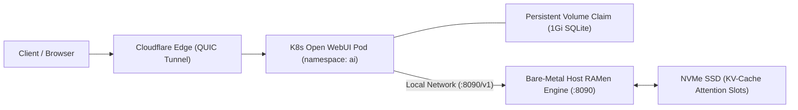

# Hybrid Private AI: K8s OpenWebUI + Bare-Metal RAMen AI

A lightweight, zero-recomputation private AI infrastructure combining a **Kubernetes-hosted Open WebUI** frontend with a bare-metal **RAMen AI Context Engine** on the Fedora host.

This architecture eliminates prompt prefill lag on resource-constrained hardware by swapping persistent KV-cache attention slots directly to SSD and enforcing a strict 2,048-token context window.

---

## 🏗️ Architecture & Data Flow



* **Public Ingress**: Outbound Cloudflare QUIC tunnel routes traffic to Open WebUI with zero open router ports.
* **In-Cluster Frontend**: Open WebUI runs in Kubernetes with persistent SQLite storage for users and chat history.
* **Bare-Metal Inference**: Open WebUI queries the host RAMen daemon over the local network (`:8090/v1`), providing unthrottled CPU AVX performance.
* **Zero-Recompute KV Cache**: Attention states snapshot to SSD (`~/.context-engine/sessions`) for sub-second conversation resumption without CPU recalculation.

---

## ⚡ Why This Architecture?

| Challenge | Standard Containerized Inference | Hybrid Bare-Metal + RAMen AI |
| :--- | :--- | :--- |
| **Prompt Prefill (TTFT)** | Recalculates entire chat history every turn (30–60s CPU lockup) | Restores KV-cache from SSD in ~50ms (Zero-Recompute) |
| **Context Window** | Unconstrained 19K–51K tokens freeze low-power CPUs | Strict 2,048-token cap (`--ctx 2048`) maintains fluid token output |
| **CPU Execution** | Throttled by container cgroups virtualization | Direct bare-metal execution with full AVX instructions |
| **Public Exposure** | Requires port forwarding or dynamic DNS | Encrypted outbound Cloudflare QUIC tunnel |

---

## 🛠️ Step-by-Step Implementation

### 1. Host Preparation & RAMen Launch

Configure the host firewall to accept incoming inference calls from the Kubernetes pod subnet, install RAMen, and launch the model engine:

```bash
# Allow port 8090 from pod network through firewalld
sudo firewall-cmd --add-port=8090/tcp --permanent
sudo firewall-cmd --reload

# Install and launch RAMen with strict 2K context
curl -fsSL https://getramenai.com/install.sh | bash
ramen start qwen3-4b --ctx 2048 --host 0.0.0.0 --port 8090
```

Verify that the local OpenAI-compatible endpoint responds:
```bash
curl http://127.0.0.1:8090/v1/models
```

### 2. Kubernetes Open WebUI Deployment

Deploy Open WebUI configured with an OpenAI API base pointing to the host's LAN IP:

```yaml
# k8s/openwebui-deployment.yaml
apiVersion: apps/v1
kind: Deployment
metadata:
  name: openwebui
  namespace: ai
  labels:
    app: openwebui
spec:
  replicas: 1
  selector:
    matchLabels:
      app: openwebui
  template:
    metadata:
      labels:
        app: openwebui
    spec:
      containers:
      - name: openwebui
        image: ghcr.io/open-webui/open-webui:main
        ports:
        - containerPort: 8080
        env:
        - name: OPENAI_API_BASE_URL
          value: "http://192.168.122.1:8090/v1"
        - name: OPENAI_API_KEY
          value: "ramen-token"
        - name: WEBUI_AUTH
          value: "true"
        volumeMounts:
        - name: data
          mountPath: /app/backend/data
        resources:
          requests:
            cpu: 250m
            memory: 512Mi
          limits:
            cpu: 1000m
            memory: 1536Mi
      volumes:
      - name: data
        persistentVolumeClaim:
          claimName: openwebui-pvc
---
apiVersion: v1
kind: PersistentVolumeClaim
metadata:
  name: openwebui-pvc
  namespace: ai
spec:
  accessModes:
    - ReadWriteOnce
  resources:
    requests:
      storage: 1Gi
```

---

## 🔍 Validation & Benchmarks

1. **Verify Pod Status**:
   ```bash
   kubectl get pods,svc,pvc -n ai
   ```
2. **Test In-Cluster DNS / HTTP connectivity**:
   ```bash
   kubectl exec -it -n ai deploy/openwebui -- curl -s http://192.168.122.1:8090/v1/models
   ```
3. **KV-Cache Verification**:
   Inspect `~/.context-engine/sessions` on the host to verify attention slot serialization after consecutive prompt turns. Tokens are processed with zero recalculation lag.
