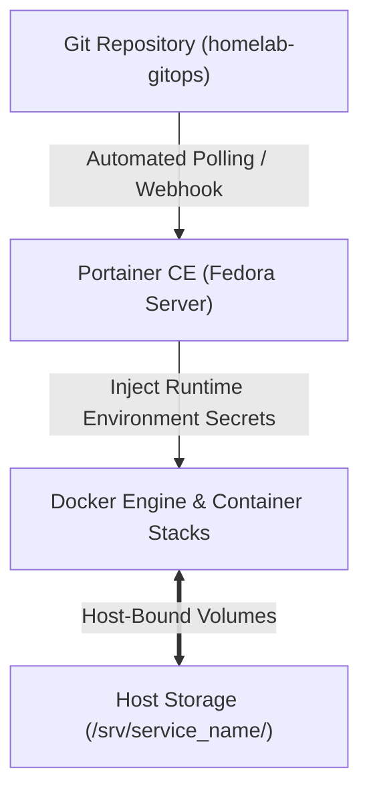

# Declarative Compose GitOps via Portainer CE

A declarative, version-controlled Docker Compose infrastructure managed via **Portainer CE** on Fedora Server, establishing Git as the single source of truth for all self-hosted containerized workloads.

---

## 🏗️ Architecture Workflow



---

## 🔑 Key Engineering Principles

### 1. Host-Bound Data Persistence (`/srv/`)
To eliminate container-internal anonymous volume drift and prevent database corruption during container redeployments:
* All persistent configuration files, application databases, and runtime downloads are bound directly to explicit host paths under `/srv/<service_name>/`.
* Directories and permission boundaries (`chown 1000:1000` or `chmod 750`) must be initialized on the host prior to triggering stack deployment.

### 2. Strict Secret & Credential Isolation
* **Zero Secrets in Git**: No credentials, API tokens, internal hostnames, or authentication keys are committed to Git.
* A top-level `.gitignore` prevents unintentional commits:
  ```gitignore
  # Security
  .env
  *.env
  *.key
  secrets/
  ```
* Operational variables are dynamically injected at runtime via Portainer's **Environment Variables** UI during stack synchronization.

---

## 📄 Stack Directory Conventions

```text
homelab-gitops/
├── README.md
├── .gitignore
├── caddy/
│   ├── docker-compose.yml
│   └── Caddyfile.template
├── monitoring/
│   ├── docker-compose.yml
│   └── prometheus.yml
├── media/
│   └── docker-compose.yml
└── tools/
    └── docker-compose.yml
```

### Example Declarative Compose Definition:

```yaml
services:
  dockhand:
    image: fopina/dockhand:latest
    container_name: dockhand
    restart: unless-stopped
    ports:
      - "8080:8080"
    environment:
      - PORT=8080
      - TZ=${TZ:-UTC}
      - SECRET_KEY=${DOCKHAND_SECRET_KEY}
    volumes:
      - /srv/dockhand/data:/data
      - /var/run/docker.sock:/var/run/docker.sock:ro
    networks:
      - internal_net

networks:
  internal_net:
    external: true
```

---

## ⚡ Deployment & Rollout via Portainer

1. Inside Portainer CE, select **Stacks** > **Add stack with repository**.
2. Point the stack source to `https://github.com/aayasir2177/homelab-gitops.git`.
3. Set the Compose path to the subdirectory (e.g. `caddy/docker-compose.yml`).
4. Enable **Automatic updates** (polling or webhook).
5. Add production variables under **Environment variables**.
6. Click **Deploy the stack**. Any new commit pushed to the designated branch automatically updates the container stack.
