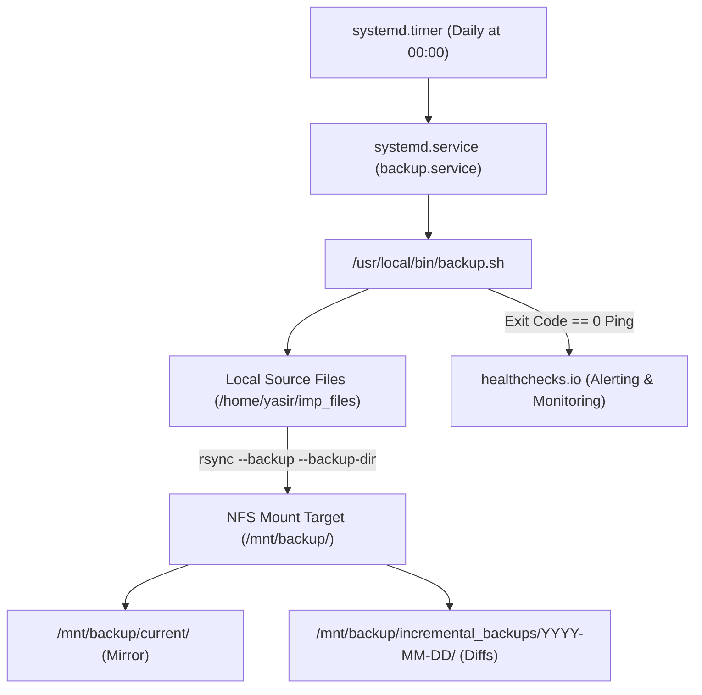

# Automated Incremental Linux Backups (rsync + systemd)

An enterprise-pattern automated backup architecture written in Bash, utilizing `rsync` differential algorithms, remote Network File System (NFS) storage, scheduled `systemd` timers, and **healthchecks.io** dead-man's switch alerting.

---

## 🏗️ Architecture & Backup Workflow



---

## 📄 Production Script Implementation (`backup.sh`)

```bash
#!/bin/bash
set -euo pipefail

# Configuration Variables
backup_src="/home/yasir/imp_files"
backup_mount="/mnt/backup"
backup_dest="${backup_mount}/current"
current_date=$(date +%Y-%m-%d)
log_path="${backup_mount}/logs"
incremental_backups="${backup_mount}/incremental_backups/${current_date}"
healthcheck_url="https://hc-ping.com/your-uuid-here"

# 1. Verify remote NFS mount availability
if ! mountpoint -q "${backup_mount}"; then 
    echo "ERROR: Backup directory ${backup_mount} is not an active mountpoint!" >&2
    exit 1
fi

# 2. Ensure target log and incremental directories exist
mkdir -p "${log_path}"
mkdir -p "${incremental_backups}"

# 3. Execute rsync with differential preservation
# --archive: preserves permissions, ownership, timestamps, and symlinks
# --backup: moves modified or deleted files into --backup-dir instead of overwriting
rsync \
    --archive \
    --verbose \
    --human-readable \
    --delete \
    --backup \
    --backup-dir="${incremental_backups}" \
    "${backup_src}/" \
    "${backup_dest}/" \
    > "${log_path}/backup_${current_date}.log" \
    2> "${log_path}/backup_${current_date}_error.log"

# 4. Notify Healthchecks.io dead-man's switch upon successful completion
curl -fsS -m 10 --retry 3 "${healthcheck_url}" > /dev/null

echo "Backup completed successfully on ${current_date}."
```

---

## ⚙️ Native Systemd Automation

Rather than relying on legacy crontabs, the backup routine is managed via `systemd` units for robust journal logging, process dependency tracking, and missed-schedule catchups (`Persistent=true`).

### 1. Service Definition (`/etc/systemd/system/backup.service`)
```ini
[Unit]
Description=Automated Daily Linux Rsync Backup
After=network-online.target nfs-client.target
Wants=network-online.target

[Service]
Type=oneshot
ExecStart=/usr/local/bin/backup.sh
User=root
StandardOutput=journal
StandardError=journal

[Install]
WantedBy=multi-user.target
```

### 2. Timer Definition (`/etc/systemd/system/backup.timer`)
```ini
[Unit]
Description=Daily rsync backup timer

[Timer]
OnCalendar=*-*-* 00:00:00
Persistent=true

[Install]
WantedBy=timers.target
```

---

## 🚀 Deployment & Operations

```bash
# 1. Install script to system binary path with strict permissions
sudo install -m 750 -o root -g root backup.sh /usr/local/bin/backup.sh

# 2. Deploy systemd units
sudo cp backup.service backup.timer /etc/systemd/system/
sudo systemctl daemon-reload

# 3. Enable and activate timer
sudo systemctl enable --now backup.timer

# 4. Verify scheduled execution
systemctl list-timers --all | grep backup
```

### Manual Trigger & Journal Verification
```bash
sudo systemctl start backup.service
journalctl -u backup.service -e
```
