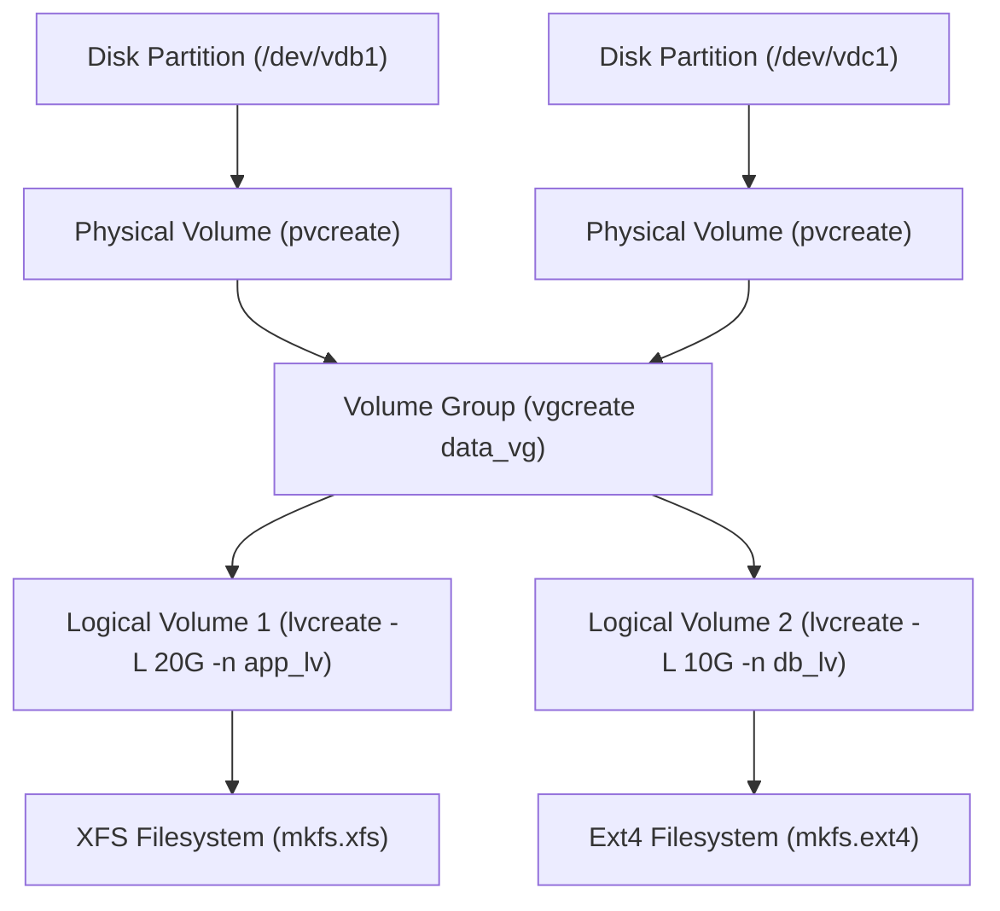

# Red Hat Certified System Administrator (RHCSA 9) Labs

Practical laboratory notes, essential commands, and enterprise procedures aligned with the Red Hat Certified System Administrator (RHCSA 9 / EX200) curriculum.

---

## 💾 1. Logical Volume Management (LVM) & Storage



### Key LVM Commands:
```bash
# 1. Initialize Physical Volumes
sudo pvcreate /dev/vdb1 /dev/vdc1

# 2. Create Volume Group with 8MB Physical Extent (PE)
sudo vgcreate -s 8M data_vg /dev/vdb1 /dev/vdc1

# 3. Create Logical Volume
sudo lvcreate -n app_data -L 25G data_vg

# 4. Format and Mount
sudo mkfs.xfs /dev/data_vg/app_data
sudo mkdir -p /var/app_data
sudo mount /dev/data_vg/app_data /var/app_data

# 5. Online Filesystem Expansion (XFS)
sudo lvextend -L +10G /dev/data_vg/app_data
sudo xfs_growfs /var/app_data
```

---

## 🛡️ 2. SELinux Security Management

SELinux enforces Mandatory Access Control (MAC) based on security contexts (`user:role:type:level`).

### Context Inspection & Restoration:
```bash
# Check current SELinux status
getenforce

# Inspect security context of files
ls -lZ /var/www/html/

# Fix incorrect context labels recursively based on system policy
sudo restorecon -Rv /var/www/html/

# Add permanent SELinux context rule for custom directory
sudo semanage fcontext -a -t httpd_sys_content_t "/custom_web(/.*)?"
sudo restorecon -Rv /custom_web
```

### SELinux Booleans & Non-Standard Ports:
```bash
# Check and toggle network connection boolean
getsebool httpd_can_network_connect
sudo setsebool -P httpd_can_network_connect on

# Allow service (e.g. Apache) to bind to non-standard port 8088
sudo semanage port -a -t http_port_t -p tcp 8088
```

---

## 🔥 3. Firewalld Zones & Network Rules

```bash
# View active zone and assigned interfaces
sudo firewall-cmd --get-active-zones

# Open services permanently in the default zone
sudo firewall-cmd --permanent --add-service=http
sudo firewall-cmd --permanent --add-service=https

# Open custom TCP/UDP ports
sudo firewall-cmd --permanent --add-port=9090/tcp
sudo firewall-cmd --reload

# Rich Rule: Restrict SSH to specific subnet
sudo firewall-cmd --permanent --add-rich-rule='rule family="ipv4" source address="192.168.122.0/24" service name="ssh" accept'
sudo firewall-cmd --reload
```

---

## 👥 4. POSIX Access Control Lists (ACLs) & Collaboration

```bash
# Set default group permissions on project folder
sudo mkdir -p /srv/devops
sudo chgrp devs /srv/devops
sudo chmod 2770 /srv/devops   # SGID bit ensures new files inherit group 'devs'

# Grant read-write ACL to specific user without modifying primary ownership
sudo setfacl -m u:intern:rw /srv/devops
sudo setfacl -d -m u:intern:rw /srv/devops  # Default ACL for future files

# Inspect active ACLs
getfacl /srv/devops
```
