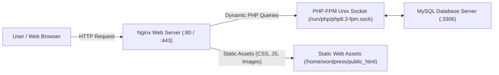

# High-Performance WordPress on LEMP Stack

Step-by-step production installation of a WordPress CMS powered by a classic **LEMP stack** (Linux, Nginx, MySQL, and PHP-FPM 8.3) on Ubuntu 24.04 LTS, with socket-based FastCGI caching and permission boundary hardening.

---

## 🏗️ Architecture & Component Flow



---

## 📦 1. Package Installation & System Hardening

```bash
# Update repositories
sudo apt update && sudo apt upgrade -y

# Install Nginx, MySQL, and PHP FastCGI Process Manager
sudo apt install -y nginx php-fpm php-mysql mysql-server php-curl php-gd php-mbstring php-xml php-zip

# Run automated MySQL security hardening
sudo mysql_secure_installation
```

---

## 🗄️ 2. Database Initialization

```sql
-- Access MySQL shell
sudo mysql

-- Create dedicated database and privileged service user
CREATE DATABASE wordpress_db CHARACTER SET utf8mb4 COLLATE utf8mb4_unicode_ci;
CREATE USER 'wp_user'@'localhost' IDENTIFIED BY 'StrongRandomPassword123!';
GRANT ALL PRIVILEGES ON wordpress_db.* TO 'wp_user'@'localhost';
FLUSH PRIVILEGES;
EXIT;
```

---

## 📂 3. Web Directory & WordPress Setup

```bash
# Download latest stable WordPress release
wget https://wordpress.org/latest.tar.gz
tar -xzvf latest.tar.gz

# Deploy to isolated directory
sudo mkdir -p /var/www/wordpress
sudo mv wordpress/* /var/www/wordpress/

# Configure wp-config.php
cd /var/www/wordpress
sudo cp wp-config-sample.php wp-config.php
```

Edit `wp-config.php` database credentials:
```php
define( 'DB_NAME', 'wordpress_db' );
define( 'DB_USER', 'wp_user' );
define( 'DB_PASSWORD', 'StrongRandomPassword123!' );
define( 'DB_HOST', 'localhost' );
define( 'DB_CHARSET', 'utf8mb4' );
```

---

## 🌐 4. Nginx Server Block Configuration

Create `/etc/nginx/sites-available/wordpress.conf`:

```nginx
server {
    listen 80;
    listen [::]:80;
    server_name blog.homenode.online;

    root /var/www/wordpress;
    index index.php index.html index.htm;

    location / {
        try_files $uri $uri/ /index.php?$args;
    }

    location ~ \.php$ {
        include snippets/fastcgi-php.conf;
        fastcgi_pass unix:/run/php/php8.3-fpm.sock;
        fastcgi_param SCRIPT_FILENAME $document_root$fastcgi_script_name;
        include fastcgi_params;
    }

    location ~* \.(js|css|png|jpg|jpeg|gif|ico|svg|woff2)$ {
        expires 30d;
        add_header Cache-Control "public, no-transform";
    }

    location ~ /\.ht {
        deny all;
    }
}
```

Enable site configuration:
```bash
sudo ln -s /etc/nginx/sites-available/wordpress.conf /etc/nginx/sites-enabled/
sudo nginx -t
sudo systemctl reload nginx
```

---

## 🔍 Post-Mortem: Troubleshooting 404 / 403 Errors

* **Problem**: Nginx threw `404 Not Found` or `403 Forbidden` after initial deployment.
* **Root Cause Analysis**: Inspecting `/var/log/nginx/error.log` via `sudo tail -n 25 /var/log/nginx/error.log` revealed permission denied errors on parent folders (`/home/wordpress/`). Nginx worker processes run as `www-data` and lacked traversal rights.
* **Remediation**:
  1. Relocated the web root to the canonical `/var/www/wordpress` directory.
  2. Applied strict ownership and directory masks:
  ```bash
  sudo chown -R www-data:www-data /var/www/wordpress
  sudo find /var/www/wordpress/ -type d -exec chmod 755 {} \;
  sudo find /var/www/wordpress/ -type f -exec chmod 644 {} \;
  ```
