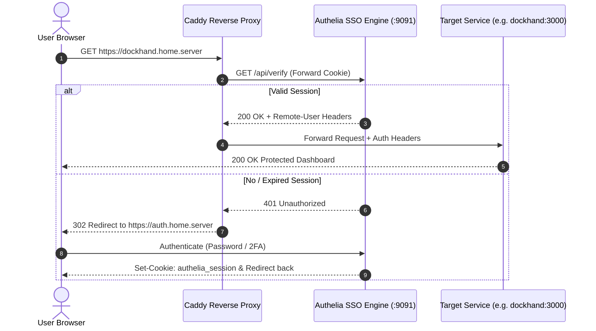

# Centralized Single Sign-On (SSO) with Caddy & Authelia

Centralized Single Sign-On (SSO) forward-authentication architecture securing local containerized homelab services (`*.home.server`) using **Caddy 2** reverse proxy and **Authelia**.

---

## Architecture & Authentication Flow

When a client requests access to a protected internal service (such as `dockhand.home.server` or `qbt.home.server`):

1. **Caddy** intercepts the incoming HTTP request.
2. **Caddy** dispatches a subrequest to Authelia's `/api/verify` endpoint via `forward_auth`.
3. **Authelia** validates the session cookie (`authelia_session`):
   - **Authenticated**: Authelia responds with `200 OK` and populates user headers (`Remote-User`, `Remote-Groups`, `Remote-Email`). Caddy proxies the request upstream.
   - **Unauthenticated**: Authelia responds with `401 Unauthorized`. Caddy redirects the client browser to `auth.home.server` for credentials / 2FA.



---

## Configuration Files

### 1. Production Caddyfile (`Caddyfile`)

```caddy
# Reusable snippet for Authelia forward authentication
(authelia_auth) {
    forward_auth authelia:9091 {
        uri /api/verify
        copy_headers Remote-User Remote-Groups Remote-Name Remote-Email
    }
}

# Centralized Authentication Portal
auth.home.server {
    tls internal
    reverse_proxy authelia:9091
}

# Management & Infrastructure Services (Protected)
dockhand.home.server {
    tls internal
    import authelia_auth
    reverse_proxy dockhand:3000
}

beszel.home.server {
    tls internal
    import authelia_auth
    reverse_proxy beszel:8090
}

# User Application Services (Protected)
qbt.home.server {
    tls internal
    import authelia_auth
    reverse_proxy qbittorrent:8080
}

# Standalone Services (Native Internal Auth)
vault.home.server {
    tls internal
    reverse_proxy vaultwarden:80
}
```

### 2. Authelia Configuration (`configuration.yml`)

```yaml
server:
  host: 0.0.0.0
  port: 9091

session:
  name: authelia_session
  domain: home.server
  same_site: lax
  expiration: 1h
  inactivity: 5m
  remember_me_duration: 1M

access_control:
  default_policy: deny
  rules:
    - domain: "auth.home.server"
      policy: bypass
    - domain: "*.home.server"
      policy: one_factor

authentication_backend:
  file:
    path: /config/users_database.yml
```

### 3. File-Based User Database (`users_database.yml`)

```yaml
users:
  aayasir217:
    disabled: false
    displayname: "Yasir"
    password: "$argon2id$v=19$m=65536,t=3,p=4$..." # Argon2id hashed password
    email: "aayasir217@gmail.com"
    groups:
      - "admins"
      - "devs"
```

---

## Security Benefits

* **Unified Access Control**: Any service - even one lacking built-in login mechanisms - is instantly secured with enterprise-grade authentication.
* **Header Injection**: Caddy passes `Remote-User` and `Remote-Email` to upstreams, enabling automatic profile recognition without secondary logins.
* **Internal TLS**: Caddy's built-in step-ca (`tls internal`) issues locally trusted certificates, preventing unencrypted plaintext internal communications.
