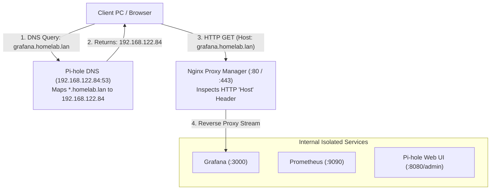

# Local DNS (Pi-hole) & Reverse Proxy (NPM)

Architecture guide for building an internal name-based resolution system using **Pi-hole** as a local authoritative DNS resolver and **Nginx Proxy Manager (NPM)** as a centralized reverse proxy.

---

## 🎯 The Core Problem & Solution

### Without Local DNS + Reverse Proxy:
* Accessing services requires remembering arbitrary IP addresses and port numbers:
  * `192.168.122.84:3000` (Grafana)
  * `192.168.122.84:9090` (Prometheus)
  * `192.168.122.84:81` (NPM Admin)
  * `192.168.122.84:8080` (Pi-hole Admin)
* Every application opens a separate port on the host interface, significantly expanding the internal attack surface.

### With Pi-hole + Nginx Proxy Manager:
* Every service is reached via human-readable domain names:
  * `grafana.homelab.lan`
  * `prometheus.homelab.lan`
  * `pihole.homelab.lan`
  * `npm.homelab.lan`
* Only ports 80 (HTTP) and 443 (HTTPS) are exposed on the proxy gateway.



---

## 🐳 Docker Compose Stack

```yaml
services:
  pihole:
    container_name: pihole
    image: pihole/pihole:latest
    ports:
      # Bind explicitly to LAN IP to avoid port 53 collision with libvirt dnsmasq
      - "192.168.122.84:53:53/tcp"
      - "192.168.122.84:53:53/udp"
      - "8080:80/tcp"
    environment:
      FTLCONF_dns_listeningMode: 'ALL'
    volumes:
      - pihole-volume:/etc/pihole
    restart: unless-stopped
    networks:
      - monitoring

  npm:
    container_name: npm
    image: 'jc21/nginx-proxy-manager:2.15.1'
    restart: unless-stopped
    ports:
      - '80:80'
      - '443:443'
      - '81:81'
    volumes:
      - npm-volume:/data
      - letsencrypt-volume:/etc/letsencrypt
    networks:
      - monitoring

volumes:
  pihole-volume: {}
  npm-volume: {}
  letsencrypt-volume: {}

networks:
  monitoring:
    name: monitoring
```

---

## 🛠️ Critical Engineering Lessons & Fixes

### 1. Port 53 Host Collision with Libvirt `dnsmasq`
* **Symptom**: `docker compose up` failed with `Bind for 0.0.0.0:53 failed: port is already allocated`.
* **Root Cause**: KVM / Libvirt runs an internal `dnsmasq` instance on `192.168.122.1:53` to provide DHCP and DNS to guest virtual machines. A default Docker port mapping `53:53` attempts to bind to `0.0.0.0` (all host interfaces), triggering a socket collision.
* **Resolution**: Bind Pi-hole explicitly to the physical LAN interface IP:
  ```yaml
  ports:
    - "192.168.122.84:53:53/tcp"
    - "192.168.122.84:53:53/udp"
  ```

### 2. The `.local` vs `.lan` TLD Conflict
* **Symptom**: `nslookup grafana.homelab.local` returned `server can't find grafana.homelab.local: REFUSED`. However, querying directly via `dig @192.168.122.84 grafana.homelab.local` worked.
* **Root Cause**: RFC 6762 strictly reserves the `.local` top-level domain for Multicast DNS (mDNS / Avahi / Bonjour). Modern Linux resolvers (such as `systemd-resolved`) will reject unicast DNS queries directed at `.local`.
* **Resolution**: Standardized on `.lan` (or `.home.arpa`) across all Pi-hole local DNS records and NPM reverse proxy hosts.

### 3. Non-Destructive Resolver Testing with `resolvectl`
Instead of modifying `/etc/resolv.conf` or editing permanent NetworkManager connection profiles during testing:
```bash
# Temporarily override DNS for network interface eno1
sudo resolvectl dns eno1 192.168.122.84

# Verify live query path
resolvectl query grafana.homelab.lan
```
This override does not alter system configuration files and cleanly resets upon reboot.

### 4. Pi-hole Admin Path Redirect
By default, navigating to `http://pihole.homelab.lan/` returned a blank screen because Pi-hole's web application is served from `/admin`. In Nginx Proxy Manager's **Custom Nginx Configuration** tab for the proxy host, add:
```nginx
location = / {
    return 301 /admin;
}
```
Visiting `http://pihole.homelab.lan` seamlessly redirects to the administrative portal.
