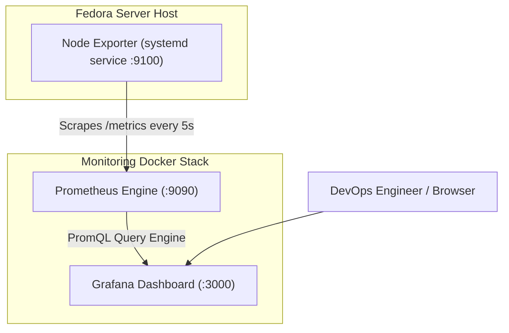

# Prometheus & Grafana Infrastructure Monitoring

A comprehensive infrastructure observability stack running on Docker, capturing host and container metrics using Prometheus, visualizing CPU/Memory/Network telemetry via Grafana, and scraping bare-metal Linux hosts with Node Exporter.

---

## 🏗️ Observability Architecture



* **Prometheus**: Time-series metrics engine with multi-target pull scraping every 5 seconds.
* **Node Exporter**: System-level telemetry collector running as a native Linux `systemd` unit directly on the bare-metal host (reporting unvirtualized CPU, load averages, memory saturation, disk I/O, and interface metrics).
* **Grafana**: Interactive visualization suite with custom host dashboards, memory saturation alerts, and live gauges.

---

## 🐳 Docker Compose Deployment (`compose.yaml`)

```yaml
services:
  prometheus:
    image: prom/prometheus:latest
    container_name: prometheus
    restart: unless-stopped
    ports:
      - '9090:9090'
    volumes:
      - './prometheus.yml:/etc/prometheus/prometheus.yml:ro'
      - 'prometheus-volume:/prometheus'
    networks:
      - monitoring

  grafana:
    image: grafana/grafana-oss:latest
    container_name: grafana
    restart: unless-stopped
    ports:
      - '3000:3000'
    volumes:
      - 'grafana-volume:/var/lib/grafana'
    networks:
      - monitoring

volumes:
  prometheus-volume: {}
  grafana-volume: {}

networks:
  monitoring:
    name: monitoring
```

---

## ⚙️ Prometheus Scrape Target Configuration (`prometheus.yml`)

```yaml
global:
  scrape_interval: 5s
  evaluation_interval: 5s

scrape_configs:
  - job_name: 'prometheus'
    static_configs:
      - targets: ['localhost:9090']

  - job_name: 'node_exporter'
    static_configs:
      - targets:
          - '192.168.122.84:9100'  # Host Primary Node
          - '192.168.122.70:9100'  # Secondary Node / VM
```

---

## 🔧 Production Troubleshooting & Post-Mortem

### 1. The "localhost" Container Trap
* **Symptom**: Prometheus threw `connection refused` when scraping `localhost:9100`.
* **Root Cause**: In container network namespaces, `localhost` resolves to the container's isolated loopback interface, not the physical Linux host where Node Exporter runs as a `systemd` service.
* **Remediation**: Explicitly configure the host's actual interface IP (`192.168.122.84:9100`) or Docker's `host.docker.internal` gateway.

### 2. Node Exporter as a Native Systemd Service
Rather than running Node Exporter inside a container (which obscures raw kernel filesystem metrics and hardware disk counters), install it directly as a host daemon:

```bash
# /etc/systemd/system/node_exporter.service
[Unit]
Description=Node Exporter
After=network.target

[Service]
User=node_exporter
Group=node_exporter
Type=simple
ExecStart=/usr/local/bin/node_exporter

[Install]
WantedBy=multi-user.target
```

Reload and start:
```bash
sudo systemctl daemon-reload
sudo systemctl enable --now node_exporter
```

---

## 📊 Useful PromQL Queries

| Metric Objective | PromQL Expression |
| :--- | :--- |
| **CPU Utilization %** | `100 - (avg by (instance) (rate(node_cpu_seconds_total{mode="idle"}[1m])) * 100)` |
| **Memory Available %** | `(node_memory_MemAvailable_bytes / node_memory_MemTotal_bytes) * 100` |
| **Disk Write Rate** | `rate(node_disk_written_bytes_total[1m]) / 1024 / 1024` (MB/s) |
| **Network RX Drop Rate** | `rate(node_network_receive_drop_total[1m])` |
