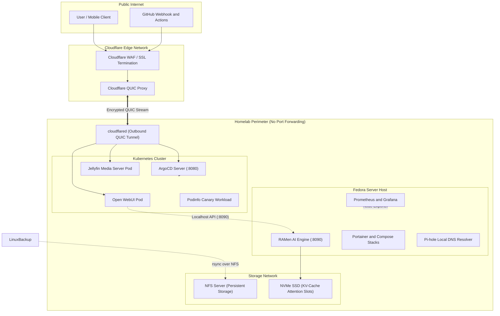

# Homelab Infrastructure Map & Design Principles

An enterprise-grade homelab designed for high reliability, minimal maintenance overhead, zero public port exposure, and sub-5-second declarative deployments.

---

## Comprehensive Architecture Diagram

The entire cluster runs on dedicated bare-metal hardware with isolated network planes, edge tunnel routing, and automated Kubernetes synchronization.

---

## Foundational Design Principles

### 1. Zero Inbound Ports (Cloudflare QUIC Tunnels)
Traditional homelab setups require opening port 80/443 on consumer router firmware and configuring Dynamic DNS (DDNS). This exposes the household WAN IP to port scans, brute-force bots, and DDoS threats.

In this homelab:
* The host runs `cloudflared` as a continuous daemon or Kubernetes Deployment.
* It initiates an **outbound-only QUIC UDP connection** to Cloudflare edge nodes across multiple regions.
* Inbound user requests terminate at Cloudflare's edge (with DDoS mitigation, WAF, and SSL/TLS termination) before being relayed down the encrypted QUIC tunnel directly to internal services.
* **Open router ports: 0.**

### 2. Git as the Authoritative Source of Truth
No service, container, or configuration file is manually edited on the production host.
* Kubernetes manifests live in Git and are reconciled by **ArgoCD**.
* Docker Compose stacks live in Git and are pulled automatically by **Portainer CE**.
* Server configurations and provisioning recipes live in **Ansible** playbooks.

### 3. Sub-5-Second Out-of-Band Sync
Default GitOps tooling relies on a polling loop (frequently set to 3 minutes in ArgoCD) to detect Git commits. By deploying an HMAC-secured GitHub Webhook through Cloudflare Edge directly into the ArgoCD API server, every push triggers immediate manifest synchronization in **less than 5 seconds**.

### 4. Storage & Persistence Isolation
* Stateful AI models and large media files are decoupled from container filesystems.
* Kubernetes PVCs utilize dedicated high-speed local NVMe storage (`hostPath` or local provisioners) for real-time inference workloads.
* Backups and long-term logs are asynchronously replicated across an internal **Network File System (NFS)** share.

---

## Network Topology & Segment Routing

