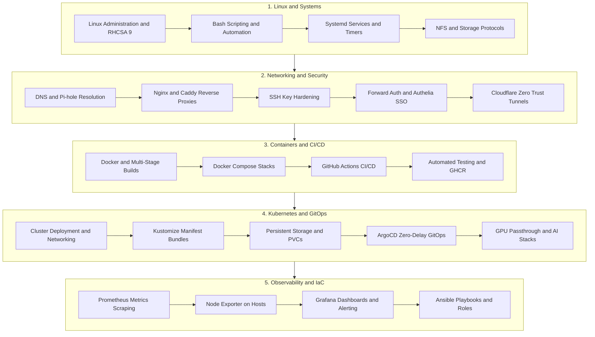

# DevOps Roadmap & Technical Journey

Welcome to the central documentation of my DevOps engineering journey. This roadmap outlines the progression from foundational Linux systems administration to advanced container orchestration, declarative GitOps workflows, and continuous integration/continuous deployment (CI/CD) pipelines.

---

## Engineering Philosophy

> **"If it's not version-controlled, declarative, and automated, it doesn't exist."**

1. **Zero Open Inbound Ports**: Never expose home routers or public IP addresses directly to the internet; utilize cryptographic outbound tunnels (Cloudflare QUIC tunnels) with edge-authenticated access.
2. **Git as Single Source of Truth**: All configurations - from Kubernetes manifests and Docker Compose stacks to systemd units - are versioned in Git repositories.
3. **Automated Drift Correction**: Systems must continuously reconcile their live operational state against declared Git state without human intervention.
4. **Least Privilege & Secret Isolation**: Secrets never touch public or private Git repositories unencrypted; credentials belong in native Kubernetes Secrets or environment runtime injections.
5. **Observability by Design**: Metrics, logs, and health status are collected at the host and container levels to eliminate operational blindspots.

---

## Progressive Roadmap and Competencies

---

## Active DevOps Projects Index

Below is the verified index of DevOps repositories maintained by [Yasir (@aayasir2177)](https://github.com/aayasir2177):

| Project | Domain | Key Technologies | Documentation |
| :--- | :--- | :--- | :--- |
| **Home Server GitOps** | GitOps / K8s | ArgoCD, Cloudflare Tunnel, GitHub Webhook, K8s Secrets | [Read Guide](/kubernetes/argocd-gitops) |
| **OpenWebUI + RAMen AI** | Kubernetes / AI | Bare-Metal AVX, SSD KV-Cache, Cloudflare QUIC, K8s | [Read Guide](/kubernetes/local-ai-ramen-openwebui) |
| **K8s Ollama + OpenWebUI** | Kubernetes / AI | Ollama, OpenWebUI, Kustomize, PVCs, ClusterIP | [Read Guide](/kubernetes/local-ai-ollama-k8s) |
| **Jellyfin on K8s** | Kubernetes / Media | Intel QuickSync / GPU Passthrough, hostPath, NodePort | [Read Guide](/kubernetes/jellyfin-k8s) |
| **Homelab GitOps** | Docker / IaC | Portainer CE, Docker Compose, `/srv/` Persistence | [Read Guide](/kubernetes/portainer-gitops) |
| **Mini Uptime Monitor** | CI/CD & Microservices | Next.js 15, Express.js, TypeScript, GitHub Actions, GHCR | [Read Guide](/cicd/mini-uptime-monitor) |
| **Dockerizing Node.js** | Containers | Dockerfile Multi-Stage, Nginx Reverse Proxy, NPM | [Read Guide](/cicd/dockerizing-nodejs-nginx) |
| **Prometheus & Grafana** | Observability | Prometheus, Grafana, Node Exporter, Pi-hole, NPM | [Read Guide](/networking/prometheus-grafana) |
| **Pi-hole & Reverse Proxy** | Networking & DNS | Pi-hole, Nginx Proxy Manager, Local `.lan` Domains | [Read Guide](/networking/pihole-npm) |
| **Caddy + Authelia SSO** | Security & Auth | Caddy 2, `forward_auth`, Authelia, 2FA, Multi-Domain | [Read Guide](/networking/caddy-authelia-sso) |
| **Linux Backup Automation** | Systems & Storage | Bash, rsync hard-links, systemd timer, NFS, healthchecks.io | [Read Guide](/linux/linux-backup-automation) |
| **Linux NFS Lab** | Storage Protocols | Fedora Server, Ubuntu Client, `/etc/exports`, fstab | [Read Guide](/linux/nfs-setup) |
| **SSH Configuration** | Linux Hardening | Ed25519 Keys, `ssh-copy-id`, Config Aliases, Port 2222 | [Read Guide](/linux/ssh-hardening) |
| **RHCSA 9 Labs** | Systems Admin | RHEL 9, LVM, SELinux, Firewalld, User Permissions | [Read Guide](/linux/rhcsa-labs) |
| **WordPress LEMP Stack** | Web Servers | Ubuntu 24, Nginx, MariaDB, PHP-FPM, Performance | [Read Guide](/linux/wordpress-lemp-stack) |
| **Audiobookshelf Docker** | Self-Hosting | Docker Compose, Volume Mapping, Metadata Scraping | [Read Guide](/linux/docker-lamp-audiobookshelf) |
| **Ansible Practice** | Configuration Mgmt | Playbooks, Roles, Inventory, Ad-Hoc Commands, KVM | [Read Guide](/automation/ansible-automation) |
| **Bash Practice** | Automation | Loops, Conditionals, Data Streams, Redirection, Tests | [Read Guide](/automation/bash-scripting) |

---

## Summary of Infrastructure Specifications

- **Hypervisors / Hosts**: Fedora Server 43 & 45 running on bare-metal hardware.
- **Virtualization**: KVM / QEMU managed via `virsh` and Ansible automation.
- **Orchestration**: Lightweight production-grade Kubernetes cluster + Docker Compose via Portainer CE.
- **Edge Routing**: Cloudflare Edge + QUIC Tunnels (`cloudflared`).
- **Storage Subsystems**: Network File System (NFS), local NVMe SSDs for KV-cache acceleration, and ZFS/ext4 arrays.
